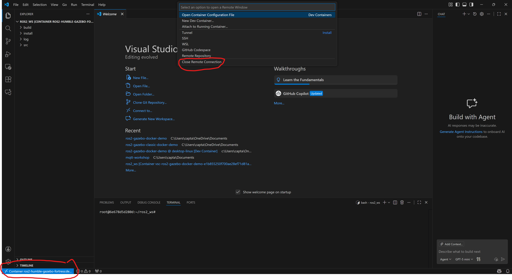
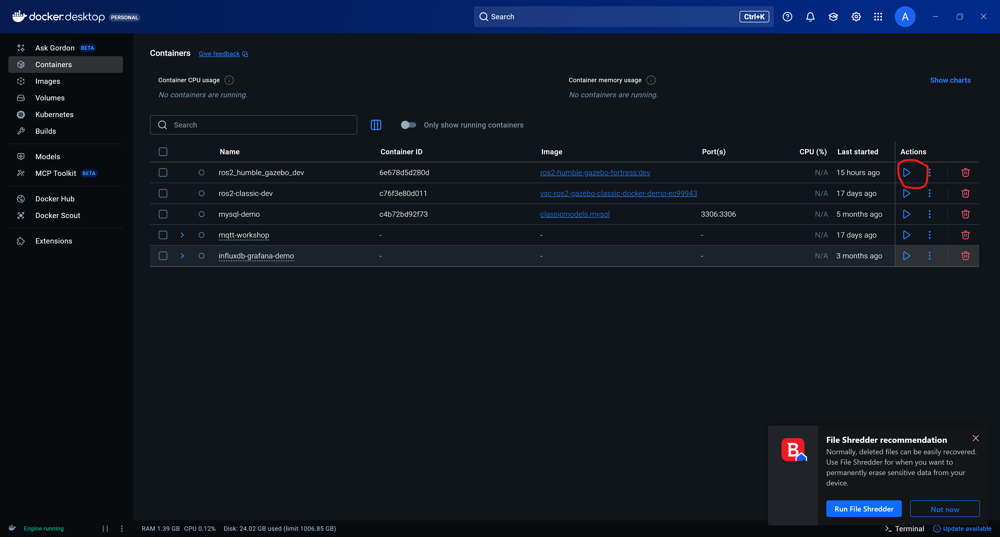
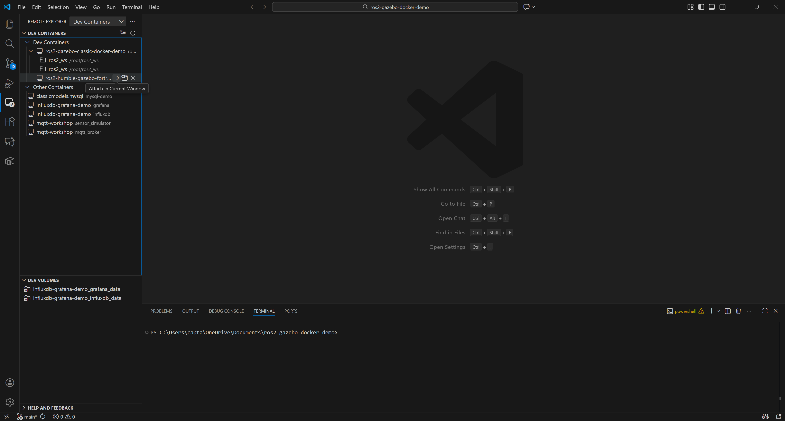

# ROS 2 Humble with Gazebo Fortress - Docker Development Environment

A Docker-based development environment for ROS 2 Humble with Gazebo Fortress (the new Gazebo), set up for Windows 11 with VS Code integration.

Once you're set up, see **[USAGE.md](./USAGE.md)** for your first package, Gazebo, the ROS–Gazebo bridge and common commands.

## Prerequisites

- Windows 11
- [Docker Desktop](https://www.docker.com/products/docker-desktop/) (with WSL2 backend)
- [VcXsrv Windows X Server](https://sourceforge.net/projects/vcxsrv/)
- [Visual Studio Code](https://code.visualstudio.com/)
- VS Code extension: [Dev Containers](https://marketplace.visualstudio.com/items?itemName=ms-vscode-remote.remote-containers) (`ms-vscode-remote.remote-containers`)
  - In VS Code, open the Extensions view (`Ctrl+Shift+X`), search for **Dev Containers** (publisher: Microsoft) and click **Install**
  - This is the only extension you install yourself. The ROS, Python and C++ extensions are installed automatically inside the container.

## What's Included

- **ROS 2 Humble Desktop Full** - complete ROS 2 installation, including RViz2 and rqt
- **Gazebo Fortress** - the new Gazebo simulator (formerly Ignition Gazebo)
- **ros_gz** - ROS 2 ↔ Gazebo bridge, plus `ign_ros2_control` and `ros2_controllers`
- **Development tools** - Git, CMake, GDB, colcon, rosdep, Black, Flake8
- **VS Code integration** - extensions and settings are installed automatically in the container

## Where Your Code Lives

Put your ROS 2 packages in the `workspace/` folder of this repository. Inside the container the same folder appears as `/root/ros2_ws/src`, so your code stays on Windows even if the container is removed.

```
ros2-gazebo-docker-demo/
├── workspace/          →  /root/ros2_ws/src   (your packages)
├── Dockerfile.fortress
├── .devcontainer/
├── run_ros2_gazebo_dev.ps1
└── config.xlaunch      (saved VcXsrv settings)
```

## Quick Start

### 1. Start the X Server (VcXsrv)

The container shows its windows (Gazebo, RViz2) through VcXsrv, so it must be running first.

**Quickest way:** double-click `config.xlaunch` in this repository. It starts VcXsrv with the settings below.

**Or configure it manually:**

1. Launch **XLaunch** from the Start menu
2. Configure settings:
   - Display: **Multiple windows**, Display number: **0**
   - Client startup: **Start no client**
   - Extra settings: **Disable access control** (Important!)
3. Click **Finish**
4. **Keep VcXsrv running** (you'll see it in the system tray)

### 2. Start the Container

Use **one** of the two options below.

#### Option A (recommended): VS Code

1. Open this folder in VS Code
2. Press `F1` (or `Ctrl+Shift+P`) → **Dev Containers: Reopen in Container**
3. The first time, the image is built automatically. This takes several minutes. After that, VS Code reuses the same container.

You're now inside the container. Open a terminal in VS Code (`` Ctrl+` ``) to start working.

To leave, click the green button in the lower-left corner and choose **Close Remote Connection**.



#### Option B: Terminal only

1. Build the image (first time only):
   ```powershell
   docker build -f Dockerfile.fortress -t ros2-humble-gazebo-fortress:dev .
   ```
2. Run the start script **from the repository folder**:
   ```powershell
   cd path\to\ros2-gazebo-docker-demo
   powershell -ExecutionPolicy Bypass -File .\run_ros2_gazebo_dev.ps1
   ```
   `-ExecutionPolicy Bypass` lets the script run for this one call only; it doesn't change any system settings.
3. Exit with `Ctrl+D`.

Next time, start and stop the container from Docker Desktop:



You can also open it in VS Code from the **Remote Explorer** tab by attaching to the running container:



> **Don't mix the two options.** Both create a container called `ros2_humble_gazebo_dev`. To switch, first remove the old one:
> ```powershell
> docker rm -f ros2_humble_gazebo_dev
> ```
> Your code in `workspace/` is not affected.

### 3. Check It Works

In a terminal inside the container:

```bash
# X server connection: a clock window should appear
xclock

# RViz2
rviz2

# Gazebo Fortress GUI
ign gazebo shapes.sdf

# Gazebo version
ign gazebo --version
```

If no window appears, check that VcXsrv is running (step 1).

## Next Steps

Continue with **[USAGE.md](./USAGE.md)**:

- Creating and building your first package
- Running Gazebo worlds
- Bridging topics between Gazebo and ROS 2
- Common commands and performance tips

## License

This project is provided as-is for educational and development purposes.

## Contributing

Feel free to submit issues and enhancement requests!
